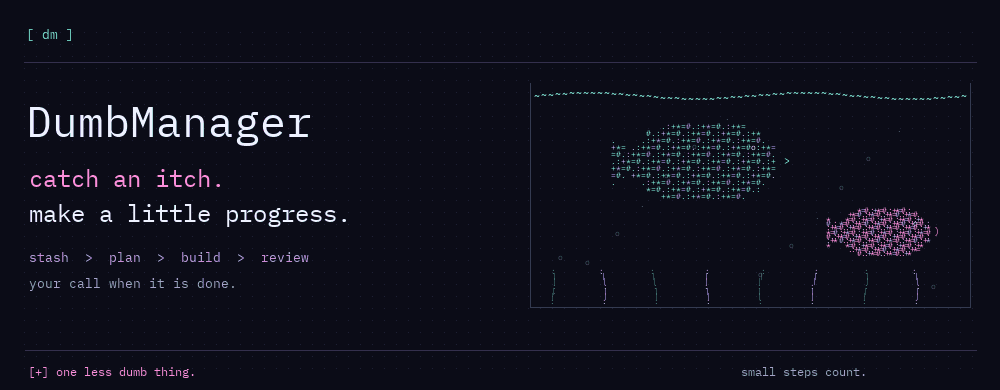
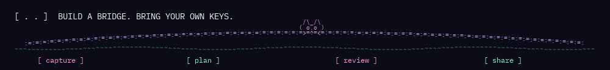

# DumbManager

DumbManager keeps the small things from getting lost: a bug you just saw, a rough idea,
a screenshot, the fix you want to test. Stash an itch, give it a plan, send it to the
right T3 conversation, and decide for yourself when it is actually done.



**This is a preview.** The check/build workflow prepares a Windows EXE, matching
source ZIP and test reports in a draft release. Clean-machine testing is still
required before publication. See [what still needs a recheck](docs/STATUS.md).

### Get going

Use the Windows EXE from Releases when a reviewed build is available. To run
from source, install Python 3.14 and Microsoft Edge. Download the source ZIP from
GitHub's **Code** menu, unzip it, then run:

```powershell
py -3.14 run.py
```

Open **Settings → Connections** and choose your existing project folder. Nothing is
connected on first launch. You can stash and review itches without an API key.
The app opens at `http://127.0.0.1:8783`; stop it with `py -3.14 run.py stop`.

Add only the connections you want:

- **Jev:** Settings → Browse. Bring your own TypeSafe key for page decisions and source ranking.
- **Mercury:** Settings → Connections → Fresh ideas. Bring your own Inception key for generated suggestions and copy.
- **T3 Code:** install T3 and reconnect from Connections. Choose the exact destination before sending work or attachments.
- **DumbBridge:** Settings → DumbBridge. Use your own Discord application and bot credentials; it stays off until you enable it.
- **Webhooks:** Settings → Posting. Save your own receiver, preview the card, then choose whether to send it.

Keys stay in your local Windows user storage and are not sent back to the browser.
Provider use is billed by your own accounts. Live provider, Discord and phone flows
still need a clean-machine recheck. FFmpeg is optional for replay; a Cloudflare
Tunnel installation is optional for phone access.

### The loop

Stash a thought or a moment. Add receipts, split a messy list into itches, and keep
the plan with the work. Review a change, ask for another pass, or explicitly accept
it. Research and learning trails keep their sources. Suggested and Inspiration
help with the next idea; Browse and chat keep the work close by.

Completion cards can be still or animated, with editable copy and privacy masks.
Sharing is your action. Saved post links are manual notes, not verified posting proof.



Prefer still images? [Aquarium](docs/assets/little-world.png) · [Bridge](docs/assets/bridge.png).
All setup steps above work without playing either animation.

[Setup details](docs/SETUP.md) · [Build and checks](docs/BUILD.md) · [Contributing](CONTRIBUTING.md)
